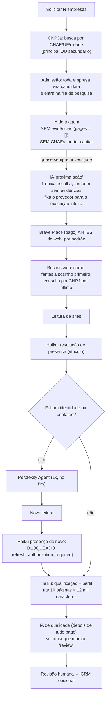

# Radar Comercial — Funil de pesquisa com portões de decisão — Plano de implantação

> **Para quem executa:** plano em tarefas sequenciais com checkboxes (`- [ ]`). Cada tarefa começa por testes RED e termina com GREEN + build + commit próprio.
> Base analisada: branch `codex/radar-brave-state-fixes`, commit `8aea99c`. Referências `arquivo:linha` apontam para esse commit; confira antes de editar, porque outras entregas podem deslocar linhas.
> **Revisão 2 (21/10/2026):** incorpora a revisão técnica da IA responsável pelo Radar (circularidade do Agent, classes de "investigar", calibração com teste independente, contagem honesta do lote, compatibilidade versionada, executor de avaliação, ordem das entregas, reabertura) e a política de uso da Perplexity Search × Agent.

> **Aceite final autorizado (21/10/2026):** reposição usa sempre `passed < ceil(minPassRatio * requested)`, sem condição fixa de 50%; uma chamada ao Agent por rodada explicitamente autorizada, nunca por toda a vida da empresa; empresas de lotes históricos podem iniciar nova rodada na revisão atual reutilizando evidências elegíveis, sem repetir descoberta ou cobranças incertas; nesta entrega calibração é exclusivamente da campanha. Implementação e testes simulados autorizados; deploy, mudanças de configuração e pilotos pagos não fazem parte desta autorização.

> **Estado da entrega local (21/10/2026):** T0–T9, incluindo T2B e T3B, implementadas e verificadas com transportes sintéticos; T10 absorvida por T3. Backend 1.375 testes, frontend 1.174, runtime 375 e integração Radar/PostgreSQL 144, todos aprovados; sete dependências opcionais do runtime e 126 casos opt-in do backend ignorados. Builds, orçamento do bundle e navegação desktop/celular aprovados. Revisão independente seguida de uma rodada de correções concluída. T11/T12, publicação, configuração real, importação do catálogo oficial e calibração humana/paga continuam pendentes. O histórico detalhado de verificação, desvios do protocolo RED-first e pendência menor está em `docs/releases/2026-10-21-radar-funnel-validation.md`; os checkboxes RED abaixo preservam o roteiro original, não são um registro de execução individual de cada exemplo.

**Objetivo:** transformar a pesquisa por empresa em um funil por etapas, com a IA de decisão (barata) posicionada **entre** as etapas como porta de economia. Empresa que não atende aos critérios para cedo e deixa de gastar. Empresa promissora recebe pesquisa progressivamente mais profunda e rica: site, contatos certos para a finalidade, redes sociais, perfil e contexto.

**Arquitetura:** os executores existentes (CNPJá, leitor de páginas, buscas, Perplexity Search e Agent, Haiku de presença e de qualificação, OpenRouter Decisions) são mantidos. O que muda é a **ordem**, os **dados enviados a cada decisão** e a introdução de **portões** com modo `off | shadow | enforce`, bloqueio reversível, estados finais distintos e trilha de auditoria por etapa.

**Stack:** Fastify/TypeScript, PostgreSQL, runtime Python (OpenRouter Decisions, Perplexity), React. Sem novo SDK, gateway ou framework.

**Fora do escopo deste plano:** ampliar a **cobertura de mercado**. O funil melhora a pesquisa das empresas que já vieram do CNPJá; não descobre empresas novas fora do cadastro. A descoberta complementar por "segmento + cidade" (web, mapas, OSM), com extração das empresas encontradas e deduplicação contra o cadastro existente, é uma evolução separada (ver Parte 7).

---

## Parte 1 — Diagnóstico do fluxo atual

### 1.1 Como o fluxo está implementado hoje



### 1.2 Problemas encontrados (com evidência no código)

| # | Problema | Onde | Efeito |
|---|---|---|---|
| P1 | **A triagem decide sem dados.** É chamada com `pages = []` e com uma identidade sem CNAEs, porte, capital, natureza jurídica ou e-mail. O próprio prompt diz que "CNAE cadastral não comprova atividade" e que "ausência não prova incompatibilidade". | `research-service.ts:185-186`; `decision-contracts.ts` (`identity` sem CNAE); `research-service.ts:843-846` (remove `websiteUrl`/`phone`) | Responde `investigate` quase sempre. Mesmo calibrada, a exclusão exige evidência primária do estabelecimento (`decision-policy.ts`), que não existe nesse ponto. **Hoje é impossível parar cedo.** |
| P2 | **"Próxima ação" é uma escolha única e cega.** É chamada uma vez, com `pages = []`, memorizada (`decisionMemo`) e usada só para trocar o provedor de **todas** as buscas. | `research-service.ts:191-198` | Não reage às evidências; não escolhe "ler página" nem "parar"; não considera custo. |
| P3 | **Capacidade verificada numa fonte, cobrança em outra.** A descoberta checa `canSearch(source)`, mas `search()` substitui a fonte pela escolhida pela IA. | `site-discovery.ts` (laço `for source`) × `research-service.ts:195-198` | Contabilidade de tentativas inconsistente; risco de gastar fora da ordem planejada. |
| P4 | **A IA de qualidade chega depois de tudo pago.** Roda no fim, só marca `review`; `ready` é ignorado. | `research-service.ts:482-484` | Custo e latência sem economia possível. |
| P5 | **Depois do Agent, a identidade não é reavaliada pelo Haiku.** Evidência nova muda o hash e a nova resolução de presença lança `radar_presence_refresh_authorization_required`. | `research-service.ts:911` | O ciclo Agent → vínculo raramente fecha. O Agent só ajuda se a página trouxer CNPJ ou nome + cidade + rua/telefone. |
| P6 | **O Agent roda por último**, depois de esgotar buscas, e sem saber se a empresa é promissora. | `research-service.ts:399-413` | O item mais caro por chamada é gasto inclusive em empresas fora do perfil, e tarde demais para economizar buscas. |
| P7 | **O e-mail cadastral não é usado na pesquisa.** O CNPJá traz `emailRaw`, que muitas vezes aponta para o domínio da empresa. | `adaptive-capture.ts:196`, `capture-operation.ts:95` gravam `emailRaw`; nada em `research-service.ts` o usa | Perde-se um candidato a site de custo zero. |
| P8 | **As descrições dos CNAEs não são guardadas.** Só a principal guarda texto; as secundárias ficam só com o código. | `cnpjaClient.ts:283-292` | Nenhuma IA consegue ler "o que a empresa faz" pelo cadastro. |
| P9 | **A ordem de custo está invertida.** Brave Place pago antes da web por padrão (`localSearchOrder='before_web'`); a primeira consulta é só o nome fantasia; a consulta por CNPJ é a última. | `search-configuration.ts` (default), `research-planner.ts:259-262` | Mais buscas por empresa para chegar à identidade. |
| P10 | **Quem decide vê pouco; quem é caro vê muito.** A decisão recebe 6 trechos de 1,5 KB; o Haiku de qualificação recebe até 10 × 12 mil caracteres. | `radar_decision_context.py`; `radar_qualification.py` | Contexto desproporcional entre quem decide e quem qualifica. |
| P11 | **Fit julgado várias vezes sem portão.** Triagem, qualificação e qualidade avaliam aderência, mas nenhuma delas evita os gastos seguintes. | pipeline inteiro | Redundância. |
| P12 | **Descoberta por CNAE secundário traz ruído.** Com `activityScope='main_or_secondary'`, qualquer empresa com o CNAE alvo entre os secundários entra. Na campanha de cozinhas industriais da Villeman e Massas apareceram tabacarias, lojas de conveniência, químicas, emissoras de vale-alimentação (ex.: Sodexo) e restaurantes. | `cnpjaClient.ts:222` (`activities.id.in`) | Lote cheio de empresas fora do perfil, todas pagando pesquisa completa. Não existe campo de campanha para bloquear isso antes da pesquisa. |
| P13 | **A operação `reanalyze` ignora as decisões.** Devolve `continue` sem chamar a decisão. | `research-service.ts:840-841` | Não serve para avaliar/calibrar portões: o resultado pareceria executado sem ter sido. |
| P14 | **A revalidação de decisões salvas usa o código vigente.** `validate_saved_decision` reconstrói o contexto com o construtor atual e exige igualdade com o empacotado salvo. | `radar_decisions.py` (`validate_saved_decision`) | Qualquer mudança de contexto/pergunta pode impedir recuperar respostas já pagas. |

### 1.3 O que é sólido e deve ser mantido

- Recibos de efeito, idempotência, lease e **nunca repetir uma cobrança incerta** (`effect-receipts`, `analysis-retry-authorizations`, `paid()` em `research-service.ts:705-774`).
- Validação de citações literais nas respostas do Haiku (`radar_qualification.py`, `validateRadarPresenceResolution`).
- Casamento determinístico de identidade: CNPJ, ou nome + cidade/UF + rua/número ou telefone (`compareRadarBusinessIdentity`).
- Limites por fonte e por empresa, governança de fontes, checagem de licenças de retenção e entrega.
- Revisão humana antes do CRM; visão comercial separada da interna (sem custo, modelo ou diagnóstico no DTO comercial).
- Transações curtas: nenhuma trava de banco é mantida durante chamada externa (padrão de reserva → commit → chamada → registro).

---

## Parte 2 — Fluxo proposto

### 2.1 Princípios

1. **Funil:** cada etapa só roda se a anterior justificar o gasto. Etapas grátis antes das pagas; pagas baratas antes das caras.
2. **A IA de decisão vive entre as etapas**, sempre com os dados já coletados. Uma decisão adicional só se justifica quando evita um gasto maior ou melhora o resultado; isso é medido no relatório.
3. **Bloqueio reversível, nunca exclusão.** A empresa bloqueada continua visível com etapa, motivo e evidência, e pode ser reaberta. A reabertura dispensa **apenas** o portão reaberto, na revisão atual, e **retoma todas as etapas pendentes** (não pula enriquecimento).
4. **Hipótese ≠ fato.** O domínio do e-mail e as URLs trazidas pelo Agent são **candidatos**. Só viram site/contato confirmado depois da verificação de identidade.
5. **Profundidade conforme a evidência, não conforme a dúvida.** "Cadastro pobre, mas plausível" merece investigação para resolver a dúvida; "sinais de baixa aderência" merecem investigação curta; "incompatibilidade comprovada" para conforme a política aprovada.
6. **Observação não interfere.** Portão em `shadow` só registra o que faria. Não reduz orçamento, profundidade nem muda a ordem das etapas; caso contrário, a comparação fica contaminada.
7. **Mecanismo no código, conhecimento na campanha.** O Radar atende clientes de qualquer segmento. O código implementa só **mecanismos**. Tudo o que descreve um segmento é configurado por campanha, de forma independente por cliente. **Nenhum CNAE, termo ou segmento pode ficar fixo no código.** Os exemplos deste documento (tabacaria, conveniência, química, vale-alimentação, restaurante) ilustram a configuração da campanha da Villeman e Massas e servem como fixtures de teste.
8. **Tudo é configurado por painel, cada coisa no painel certo:**
   - **Painel do cliente (editor da campanha):** controles comerciais simples — perfis de alvo e prioridades, exemplos fora do escopo, CNAEs alvo e bloqueados, termos bloqueados no nome, regra de atividade principal, finalidade do contato, reposição mínima do lote.
   - **Admin YUX:** controles técnicos — modos dos portões, limiares, calibração e auditoria, política de uso do Agent e orçamentos, limites de páginas, pisos de plataforma, rotas e modelos, política global de domínios de e-mail.
   - O cliente não precisa conhecer probabilidades, modelos ou a estrutura interna. Nada depende de deploy.
9. **Toda decisão deixa rastro:** etapa, modo, resultado, motivo, evidências, custo estimado e real.
10. **Custos são estimativas até serem medidos.** Os valores deste plano vêm da configuração atual; a verdade são os recibos.

### 2.2 Diagrama do novo fluxo

```mermaid
flowchart TD
  S["Solicitar N empresas"] --> R["E0 · CNPJá<br/>razão social, nome fantasia, CNAEs com descrição,<br/>porte, capital, natureza, abertura, e-mail, telefone"]
  R --> G0{"G0 · Regras cadastrais da campanha<br/>(grátis, determinístico)"}
  G0 -->|"regra de exclusão configurada casou"| X0["Fora do perfil (G0)<br/>motivo + regra · R$0"]
  G0 -->|"passa ou dúvida"| G1{"G1 · Triagem cadastral (IA de decisão)<br/>fatos cadastrais + perfis de alvo da campanha"}
  G1 -->|"incompatibilidade comprovada (enforce)"| X1["Fora do perfil (G1)"]
  G1 -->|"compatível · plausível sem dados · baixa aderência"| E2["E2 · Sinal do e-mail (grátis)<br/>genérico → 'não indica site'<br/>contábil → baixa prioridade<br/>corporativo → candidato a site"]
  E2 -->|"candidato corporativo"| E2b["Leitura do domínio (grátis)<br/>identidade confirmada?"]
  E2b -->|"sim"| E4
  E2b -->|"não"| G3
  E2 -->|"sem candidato"| G3
  G3{"G3 · Próxima ação por passo (IA de decisão, com custos)<br/>Perplexity Search rápida · busca padrão · local · ler página<br/>· Agent (se elegível) · parar"}
  G3 -->|"busca barata"| B["Busca: 'nome' cidade UF → CNPJ → razão social → nome"]
  B --> H["Leitura das páginas candidatas"] --> G3
  G3 -->|"escalar para o Agent<br/>(empresa promissora, caminho barato não resolveu)"| AG["Perplexity Agent — 1 chamada para TODAS as lacunas<br/>identidade · site · contatos da finalidade · WhatsApp · redes"]
  AG --> H2["Leitura das URLs citadas (grátis)"] --> E4
  G3 -->|"parar"| E4["E4 · Identidade<br/>determinística primeiro; Haiku de presença se houver ambiguidade<br/>(reavaliação permitida 1x após evidência nova)"]
  E4 --> G5{"G5 · Portão de aderência (IA de decisão)<br/>site + cadastro · sem site não bloqueia"}
  G5 -->|"incompatibilidade comprovada (enforce)"| X5["Fora do perfil (G5)"]
  G5 -->|"compatível / precisa de evidência"| E6["E6 · Enriquecimento grátis conforme a finalidade<br/>páginas de contato/compras · WhatsApp · redes oficiais<br/>Agent só se ainda houver lacuna e ele não tiver rodado"]
  G5 -->|"baixa aderência"| Q
  E6 --> Q["E7 · Haiku: qualificação + perfil (1x)"]
  Q --> E8["E8 · Qualidade determinística"]
  E8 --> F1["Pesquisa concluída<br/>(com ou sem lacunas explicadas)"] --> HR["Revisão humana → CRM opcional"]
  X0 -.->|"reabrir: dispensa só G0"| G1
  X1 -.->|"reabrir: dispensa só G1"| E2
  X5 -.->|"reabrir: dispensa só G5"| E6
```



### 2.3 As etapas em detalhe

**E0 · Fatos cadastrais completos (CNPJá).** Além do que já é salvo, guardar `registryActivities: [{code, text, main}]` com a descrição de cada CNAE. O texto já vem no payload do CNPJá (`mainActivity.text`, `sideActivities[].text`).

**G0 · Regras cadastrais determinísticas (grátis).** **O código só executa regras; todos os valores vêm de campos da campanha**, preenchidos no editor de campanha do painel do cliente. Cada campanha tem suas próprias listas. Uma campanha nova começa com listas vazias e, nesse caso, G0 não bloqueia nada.

| Campo da campanha (painel do cliente) | O que faz | Padrão |
|---|---|---|
| `target_cnaes` (existente) | CNAEs alvo usados na busca do CNPJá | definido pela campanha |
| `qualification.targets` | **Perfis de alvo com prioridade**: `key`, `label`, `definition`, `priority` (`primary`/`secondary`), `cnaes` de apoio opcionais | `[]` |
| `qualification.outOfScopeExamples` | Exemplos do que **não** é alvo | `[]` |
| `qualification.registry.blockedMainCnaes` | CNAEs (subclasse ou prefixo de classe/grupo/divisão) que bloqueiam quando são o **principal** e nenhum CNAE alvo é principal | `[]` |
| `qualification.registry.mainActivityRule` | `any` (atual) · `target_main_required` · `target_secondary_needs_review` (alvo só como secundário vai para G1 com a marca `alvo_apenas_secundario`) | `any` |
| `excludedNameTerms` (existente) + `qualification.registry.blockedNameTerms` | Termos que bloqueiam no nome fantasia/razão social normalizados. `excludedNameTerms` já vai ao CNPJá como `names.nin`; G0 repete a checagem localmente | `[]` |
| `research.contactPurpose` (existente) | Finalidade do contato (fornecedores, vendas…) | `general` |
| `batch.minPassRatio` | Reposição mínima do lote (ver 2.6) | `0.5` |

**Exemplo ilustrativo** — campanha de cozinhas industriais da Villeman e Massas, **digitada no painel do cliente** (conferir códigos na CONCLA):
- `targets`: `primary` "Cozinha industrial: produção de refeições em escala para empresas, hospitais, escolas e indústrias"; `secondary` "Fornecedora de refeições / refeição coletiva";
- `blockedMainCnaes`: 4729-6/01 (tabacaria), 4729-6/02 (conveniência), 8299-7/02 (emissão de vales-alimentação), prefixo `20` (químicos);
- `mainActivityRule`: `target_secondary_needs_review`;
- `outOfScopeExamples`: restaurante à la carte, lanchonete, tabacaria, loja de conveniência, emissora de vale-refeição, indústria química.

**Resultado de G0:** `pass`, `block` (regra + valor que casou, ex.: `blocked_main_cnae:4729-6/01`) ou `doubt` (vai para G1).

**Catálogo de CNAEs:** importar o catálogo oficial de subclasses CONCLA/IBGE como tabela de referência (`radar_cnae_catalog`), usada no autocomplete do editor. Dado neutro, sem regra embutida.

**G1 · Triagem cadastral pela IA de decisão.** Reaproveita a tarefa `radar_initial_triage` com novo contexto (versão nova, ver T3B):
- **Evidência cadastral:** `role: 'registry'`, `primary: true`, `scope: 'establishment'`, `sourceUrl: https://cnpja.com/office/<cnpj>`. Texto compacto (≤1.400 bytes): nome fantasia, razão social, CNAE principal com descrição, até 15 secundários (os que casam com o alvo primeiro), natureza, porte, capital, abertura, classe do e-mail, marcas do G0.
- **Critérios:** perfis de alvo (`targets`) e `outOfScopeExamples` da campanha. Instrução genérica no código: julgar a **atividade real dominante**; um CNAE alvo isolado entre muitos de outra natureza não sustenta compatibilidade; nome que explicita outra atividade é evidência forte.
- **Escolhas (4 classes):**

| Escolha | Significado | Efeito em `enforce` | Em `shadow` |
|---|---|---|---|
| `compatible` (+ `matchedTargetKey`) | Cadastro sustenta um perfil de alvo | caminho completo | só registra |
| `plausible_needs_evidence` | Cadastro pobre/ambíguo, mas potencial plausível | caminho completo, com elegibilidade ao Agent para resolver identidade | só registra |
| `weak_fit` | Sinais de baixa aderência, sem contradição explícita | investigação curta (orçamento configurável no Admin, sem Agent) | só registra |
| `outside_profile` | Incompatibilidade explícita com evidência cadastral primária | bloqueia | registra `would_block` |

- A prioridade do perfil (`primary`/`secondary`) é derivada da configuração, nunca do modelo.
- Roda antes de qualquer efeito pago, depois da aquisição do lease.

**E2 · Sinal do e-mail cadastral (grátis).**

| Classe | Regra | Tratamento | Texto registrado |
|---|---|---|---|
| `absent` | sem e-mail | segue para G3 | "Sem e-mail cadastral para indicar o site." |
| `generic_provider` | domínio na lista global de provedores (gmail, hotmail, outlook, live, yahoo, icloud, bol, uol, terra, ig, globo…) | segue para G3 | "E-mail genérico (gmail.com): não foi possível indicar o site real pelo e-mail." |
| `possible_accountant` | domínio com termo da lista global de contabilidade/assessoria | baixa prioridade; nunca vira site sem prova | "Domínio do e-mail parece de escritório contábil/assessoria; não indica o site da empresa." |
| `corporate_candidate` | demais domínios públicos válidos | lê `https://<domínio>/` (até 2 páginas) com o leitor próprio | "Domínio do e-mail é candidato a site; requer confirmação de identidade." |

- As duas listas ficam numa **política global editável no Admin YUX** (`radar_email_domain_policy`), criada por migração com valores iniciais.
- Confirmação só pela regra determinística (`directlyOwns`). Sem confirmação, o domínio vira dica (candidato e consulta `site:` em G3), nunca site. Escopo `group` continua valendo.
- Persistência: `emailDomainSignal: {domain, kind, outcome, messagePt, checkedAt}`.

**G3 · Próxima ação por passo.** `radar_next_action` é chamada **a cada passo**, com as evidências até ali.
- **Opções** (só as elegíveis, com capacidade, licença e preço na descrição): `search_perplexity_fast`, `search_<provedor padrão>`, `local_brave_place`, `read_<hash>`, `agent_research` (só quando elegível, ver 2.4), `stop`.
- **Atalhos sem IA:** identidade confirmada + contatos mínimos → `stop`; opção única → executa; capacidade zero → `stop`. Teto de decisões estourado → ordem determinística mais barata.
- **Ordem das consultas:** `"<nome fantasia>" <cidade> <UF>` → `"<CNPJ formatado>"` → `"<razão social>" <cidade>` → nome sozinho → `site:<domínio candidato> contato`.
- `localSearchOrder` passa a `after_web_if_needed` (só para campanhas sem valor salvo).
- **Correção de P3:** a fonte decidida é a mesma checada, reservada e cobrada.
- G3 não exclui empresa; opera em modo `effective` por configuração do Admin, sem calibração.

**E4 · Identidade.** Determinística primeiro; Haiku de presença só com ambiguidade. **Correção de P5:** nova resolução permitida quando chega evidência nova (Agent ou E2), até `maxPresenceResolutionsPerCompany` (padrão 2), guardando a anterior em `previous`.

**G5 · Portão de aderência (nova tarefa `radar_fit_gate`).** Depois da identidade, antes do enriquecimento, do Agent residual e da qualificação.
- **Escolhas:** `compatible`, `needs_evidence`, `weak_fit`, `outside_profile` (mesma semântica de G1).
- **Sem site confirmado, G5 não bloqueia:** no máximo `needs_evidence`. A empresa promissora continua elegível ao Agent para resolver a identidade (corrige a circularidade "Agent depende de identidade que ele mesmo deveria resolver").
- `outside_profile` em `enforce` exige evidência de atividade no site associado.

**E6 · Enriquecimento conforme a finalidade.**
- Leitura dirigida e gratuita no domínio confirmado, conforme `contactPurpose`: fornecedores → `/fornecedores`, `/compras`, `/seja-fornecedor`, `/suprimentos`; vendas → `/contato`, `/orcamento`. **`/trabalhe-conosco` não é usado** (canal de recrutamento, comercialmente inútil).
- WhatsApp publicado (`wa.me`, `api.whatsapp.com/send`), redes oficiais vinculadas pelo site.
- Agent residual só se ainda faltar algo **e** o Agent ainda não tiver rodado para a empresa.

**E7 · Qualificação + perfil (Haiku 5.5, 1x).** Evidência enxuta (`selectRadarQualificationEvidence`: home, sobre, serviços, clientes, contato; até 5 × 6 mil caracteres). Alertas de revisão em `limitations`.

**E8 · Qualidade determinística.** `evaluateRadarResearchQuality`. A chamada `radar_quality_gate` sai do caminho principal (a tarefa continua registrada).

### 2.4 Perplexity: Search × Agent — o modelo certo na hora certa

São dois usos diferentes, com custos e papéis diferentes. O plano usa os dois.

| | Perplexity Search | Perplexity Agent |
|---|---|---|
| O que é | Mecanismo de busca: devolve resultados (título, URL, trechos) | Pesquisa em vários passos (`web_search` + `fetch_url`, até `max_steps`), com conclusões citadas |
| Custo estimado (configurado) | rápida ~R$0,007 · padrão ~R$0,035 por consulta | ~R$0,21 por chamada (US$0,03 estimado; varia com passos e ferramentas; **sem teto remoto**) |
| Papel no funil | **Primeira tentativa barata** em G3 | **Escalada** para empresas promissoras cujo caminho barato não resolveu |

**Avaliação da hipótese "o Agent, bem usado, substitui outras etapas de aprofundamento":** é correta para os **casos difíceis** e é o que este plano adota.
- Quando o caminho barato falha, a alternativa seria gastar 3–5 buscas pagas (~R$0,10–0,18 no preço padrão) e ainda assim, muitas vezes, terminar sem identidade. Nesses casos, **escalar cedo para o Agent custa parecido e traz resultado mais completo**: uma chamada pode resolver identidade, site, contatos da finalidade, WhatsApp e redes de uma vez.
- Quando o caminho barato resolve (site pelo domínio do e-mail, grátis; ou uma busca rápida, ~R$0,007), usar o Agent custaria **de 6 a 30 vezes mais** sem ganho relevante. Por isso o Agent não é o padrão para todas as empresas.

**Política do Agent (configurada no Admin YUX, por campanha):**
1. **Elegibilidade:** empresa não bloqueada, com lacuna real (identidade ou contato útil da finalidade) e orçamento disponível. Quando G1 estiver em `enforce`, também classe `compatible` ou `plausible_needs_evidence`; em `shadow`, a classe de G1 **não** restringe (princípio 6). `funnel.agentPolicy.priorities` permite limitar a perfis `primary` (padrão: `primary` e `secondary`).
2. **Momento — escalada antecipada:** a opção `agent_research` aparece em G3 **depois da primeira tentativa barata sem candidato institucional** (`funnel.agentPolicy.timing = after_first_cheap_attempt`, padrão), em vez de esperar o fim de todas as buscas. Alternativa configurável: `immediately_when_no_site_candidate` (logo após E2 sem candidato).
3. **Uma chamada, todas as lacunas:** o pedido ao Agent lista todas as lacunas da empresa e a finalidade (ex.: identidade, site oficial, canal de compras/fornecedores, WhatsApp comercial, Instagram/LinkedIn oficial, contexto da operação). Depois dele, **não há segunda chamada nem rodada extra de buscas pagas** para a mesma empresa; seguem só os passos gratuitos de validação (ler as URLs citadas, conferir identidade, extrair contatos).
4. **Nada é confirmado automaticamente:** URLs e afirmações do Agent viram candidatos; identidade passa por E4 (com reavaliação permitida) e contatos só são associados com origem verificável.
5. **Orçamento:** por investigação e por campanha, estimados e monitorados (como hoje). Para o piloto de 50, revisar o orçamento por campanha no Admin: a configuração atual do experimento (US$1 por campanha) cobre ~33 chamadas, apertado com reposição. Sugestão: US$2 para o piloto, conferindo os recibos.
6. **Medição:** o relatório mostra, por empresa, o caminho percorrido (barato resolveu × escalou para o Agent) e o custo por empresa aderente com contato útil em cada caminho.

### 2.5 Custos estimados por empresa

Câmbio de USD/BRL 6 com margem de 15% (~R$6,90 por dólar). **Todos os valores são estimativas** da configuração atual; os reais estão nos recibos (`radar_analysis_receipts.cost_usd`, `calls.*.costEstimate`).

| Item | Custo estimado |
|---|---|
| Decisão (OpenRouter) | ~US$0,0005 ≈ R$0,0035 por chamada |
| Perplexity Search rápida / padrão | ~R$0,007 / ~R$0,035 por consulta |
| Serper / Brave | preço configurado na fonte (Admin) |
| Perplexity Agent | ~US$0,03 ≈ R$0,21 por chamada (sem teto remoto) |
| Haiku 5.5 presença (rota atual) | ≈ R$0,005–0,01 |
| Haiku 5.5 qualificação com perfil | ≈ R$0,015–0,025 |

| Desfecho | Hoje | Funil |
|---|---|---|
| Fora do perfil por regra (G0) | pesquisa completa (~R$0,3–0,5) | R$0 |
| Fora do perfil na triagem (G1, `enforce`) | pesquisa completa | ≈ R$0,0035 |
| Fora do perfil no portão de aderência (G5, `enforce`) | pesquisa completa | ≈ R$0,02–0,10 |
| Promissora, site achado pelo e-mail | buscas + Haiku | sem busca paga até G5 |
| Promissora, caminho barato falhou | buscas até esgotar + Agent no fim | 1 busca barata + Agent (escalada) |

**Métrica principal:** custo por **empresa aderente com contato útil para a finalidade** (e, depois, por lead aprovado na revisão humana). O relatório também compara o gasto em decisões com o gasto evitado.

### 2.6 Estados da empresa e contagem do lote

**Estados finais distintos** (corrige a mistura atual entre descarte comercial e falha técnica):

| Estado | Significado | Retomada técnica? |
|---|---|---|
| `out_of_profile` | Bloqueada por G0/G1/G5 em `enforce`; reversível pela reabertura | Não |
| `completed` | Pesquisa concluída com os dados encontrados | Não |
| `completed_with_gaps` | Pesquisa concluída; dados ausentes explicados (ex.: "e-mail genérico", "site não encontrado nas fontes consultadas") | Não |
| `technical_failure` | Falha técnica (lease perdido, provedor indisponível, resposta incerta) | **Sim** — só este estado exige retomada |

O lote fecha quando todos os itens estão em estado final; `technical_failure` aparece com a ação "Retomar".

**Contadores (nomes honestos):**
- `requested` (solicitadas), `admitted` (admitidas), `blockedInitial` (bloqueadas por G0 e por G1 em `enforce`), **`passedInitialTriage` ("passaram pela triagem inicial")**, `blockedFit` (bloqueadas em G5), **`confirmedFit` ("aderentes confirmadas", só depois de G5 + qualificação)**, `withUsefulContact`, `approvedByHuman`.
- Nenhuma tela mostra "aprovada" antes de a aprovação acontecer.

**Reposição (Decisão D2):** as bloqueadas contam no lote. Se `blockedInitial > 50%`, o lote busca novas empresas até `passedInitialTriage ≥ ceil(minPassRatio × requested)`. A base é a **triagem inicial**, porque é o que se sabe cedo e barato; a aderência final é reportada à parte. O Admin pode trocar a base para `final_fit` (`batch.replenishmentBasis`), que espera a pesquisa completa antes de repor (mais lento, mais preciso).

### 2.7 Governança dos portões

- **Painel do cliente:** define o público (perfis, exclusões, CNAEs, termos, finalidade, reposição mínima).
- **Admin YUX:** define modos (`off/shadow/enforce` para G1/G5, `off/enforce` para G0, `off/effective` para G3), limiares, calibrações, auditoria, política do Agent, orçamentos e limites. O cliente vê só o efeito comercial ("bloqueada por regra da campanha: CNAE principal 4729-6/01 — Tabacaria").
- **G0:** `enforce` liberado pelo Admin depois da checagem offline (T12) sem custo.
- **G1/G5:** começam em `shadow`; `enforce` exige calibração global ou **calibração da campanha** aprovada (Parte 5).
- **Aplicação:** bloqueio em `enforce` só depois de reconferir lease, revisão da campanha e calibração vigente (padrão `assertEffectAuthorization`).
- **Reabertura:** motivo obrigatório; cria `funnelOverride: {gate, configurationRevision, by, reason, at}` — dispensa só aquele portão naquela revisão; os outros portões continuam valendo; a pesquisa retoma todas as etapas pendentes, reaproveitando recibos. Substitui o uso de `manualDecisionOverride` como dispensa global.
- **Plano do experimento de 21/10 (1 + 10 sem bloqueio):** substituído pelo piloto de 50 (D1). Se já implementado, ajustar `bindRadarDecisionExperimentCapture` ou executar o piloto pelos modos de portão.

---

## Parte 3 — Plano de implementação

### Restrições globais

- **Nenhum conhecimento de segmento no código.** CNAEs, termos, perfis de alvo, exemplos fora do escopo, limiares e critérios são campos de campanha ou políticas do Admin. Revisão de código rejeita CNAE ou termo de negócio fixo fora de fixtures.
- **Shadow não interfere** no orçamento, na profundidade nem na ordem das etapas (teste obrigatório em T4 e T7).
- Não repetir chamadas incertas; preservar recibos, leases e idempotência. Respostas antigas continuam recuperáveis após mudança de versão (T3B).
- Transações curtas; nenhuma trava de banco durante chamada externa; permissões mínimas (API lê, worker grava, como nas tabelas de recibos).
- Desenvolvimento e testes sem chamadas pagas (transportes simulados).
- Somente `yux_admin` vê etapas técnicas, custos, modelos, probabilidades e calibrações. DTO comercial em allowlist.
- Bloqueio é reversível; nenhuma exclusão de dado, envio ao CRM ou aprovação comercial automática.
- Migrações aditivas, com a próxima numeração livre no momento da execução. Editar só no worktree do Radar.

### Ordem e dependências

```
T0  Estados finais, eventos e reconciliação mínimos  ← vem antes de tudo que bloqueia
T1  Fatos cadastrais + sinal do e-mail
T2  G0 configurável + catálogo CNAE                   (depende de T0)
T2B Contagem honesta + reposição                      (depende de T0, T2)
T3  Política de portões, calibração da campanha, executor de avaliação, reabertura com escopo
T3B Compatibilidade versionada de decisões + retomada de pesquisas e lotes antigos
T4  G1 com 4 classes                                   (depende de T3, T3B)
T5  Sonda do domínio (E2)                              (depende de T1)
T6  G3 por passo + opção Agent                         (depende de T3B)
T7  G5 + política do Agent + reavaliação de identidade + fim da IA de qualidade
T8  Enriquecimento por finalidade + qualificação enxuta
T9  Métricas, painel e relatório do lote
T10 (reservado — absorvido por T3: executor de avaliação)
T11 Pré-piloto pequeno do fluxo completo
T12 Villeman: configuração, verificação dos positivos, calibração com teste independente, piloto de 50
```

T0, T1, T2 e T2B podem ir para produção sem IA nova. O piloto de 50 só roda depois do pré-piloto (T11) aprovado.

---

### Task 0: Estados finais, eventos e reconciliação mínimos

**Arquivos:** migração `02XX_radar_funnel_states.sql`; `capture-research-state.ts`, `capture-reconciliation.ts`, `commercial-status.ts`, `research-service.ts` (`persistDossier`), `types.ts`; frontend: rótulos de estado no workspace.

**Entregas:**
- Estados `out_of_profile`, `completed`, `completed_with_gaps`, `technical_failure` para itens do lote e para a pesquisa; mapeamento a partir dos estados atuais (`succeeded`, `partial`, `blocked`) sem perder histórico: `partial` com limitações só de dados → `completed_with_gaps`; `blocked` com código técnico → `technical_failure`.
- Tabela `radar_funnel_events` (gate, mode, outcome, would_block, reason_code, evidence_ids, decision_request_id, cost_estimate_brl, created_at), RLS/grants iguais aos dos recibos.
- Reconciliação: lote fecha com todos os itens em estado final; só `technical_failure` oferece "Retomar".

**Passos:**
- [ ] RED: lote com mistura de estados fecha corretamente; `out_of_profile` não pede retomada; `completed_with_gaps` não vira falha; mapeamento de runs antigos preserva histórico; quatro papéis no acesso aos eventos.
- [ ] Migração (banco limpo e com dados), implementação, GREEN, commit.

### Task 1: Fatos cadastrais completos e sinal do e-mail

**Arquivos:** `cnpjaClient.ts`, `adaptive-capture.ts`, `capture-operation.ts`, `company-projection.ts`, `types.ts`; novo `email-domain.ts`; migração da política `radar_email_domain_policy` + editor no Admin global.

**Interfaces:**
- `CnpjaCandidate.activities: Array<{code; text?; main}>` (preserva `cnaeMain`/`cnaes`).
- `classifyRadarEmailDomain(email, policy: {genericProviders; accountantTokens})` — função pura; listas por parâmetro.
- Payload: `registryActivities`, `emailDomainSignal`.

**Passos:**
- [ ] RED: normalização com/sem texto de CNAE; classificador (gmail, hotmail.com.br, outlook, bol, uol, domínio contábil, domínio corporativo, inválido, IP/localhost); domínio acrescentado na política passa a genérico sem deploy.
- [ ] Implementar; gravar nas admissões v1 e v2; backfill gratuito de `registryActivities` a partir de `raw_payload`.
- [ ] GREEN, commit.

### Task 2: G0 — regras cadastrais configuráveis por campanha

**Arquivos:** `search-configuration.ts`, `capture-operation.ts`, `adaptive-capture.ts`, `capture-dispatch.ts`; novo `registry-gate.ts`; migração `radar_cnae_catalog` + script de importação idempotente CONCLA/IBGE; `GET /radar/cnae-catalog?q=`; editor da campanha no painel do cliente (`RadarWorkspace.tsx` ou componente de configuração).

**Schema (defaults vazios):**

```ts
qualification: {
  targets: z.array(z.object({ key, label, definition, priority: z.enum(['primary','secondary']), cnaes: z.array(cnaeOrPrefix).default([]) }).strict()).max(10).default([]),
  outOfScopeExamples: terms.default([]),
  registry: z.object({
    mainActivityRule: z.enum(['any','target_main_required','target_secondary_needs_review']).default('any'),
    blockedMainCnaes: z.array(cnaeOrPrefix).max(200).default([]),
    blockedNameTerms: terms.default([]),
  }).strict(),
}
batch: { minPassRatio: z.number().min(0).max(1).default(0.5) }
```

- `evaluateRadarRegistryRules({payload, targetCnaes, configuration})` → `{outcome, rule?, matchedValue?, reasonPt, flags}`. Função pura; todos os valores vêm da configuração.
- Bloqueado em G0 (`enforce`): candidato visível, item `out_of_profile`, não despachado.
- Reavaliação gratuita (só G0) das empresas já salvas, disparada pelo Admin, para checagem antes de ativar.

**Passos:**
- [ ] RED com fixtures da campanha Villeman (valores só no teste): tabacaria/conveniência/vale configurados → `block`; prefixo `20` → `block`; restaurante com alvo só secundário → `doubt` + `alvo_apenas_secundario`; termo configurado → `block`; alvo principal → `pass`.
- [ ] RED de neutralidade: configuração vazia não bloqueia; campanhas diferentes avaliam de forma independente.
- [ ] Teste estático: nenhum padrão de CNAE (`\d{4}-\d/\d{2}`) em `backend/src/modules/radar` fora de testes/fixtures.
- [ ] UI do painel do cliente — seção "Público-alvo e filtros": perfis de alvo (nome, definição, prioridade, CNAEs de apoio), exemplos fora do escopo, CNAEs bloqueados (autocomplete com descrição, aceita prefixo), regra de atividade principal, termos bloqueados, finalidade do contato, reposição mínima (%). Ajuda: "Cada campanha tem seus próprios filtros. Empresas bloqueadas continuam visíveis e podem ser reabertas." Sem probabilidades, modos ou modelos.
- [ ] GREEN, build, commit.

### Task 2B: Contagem honesta do lote e reposição

**Arquivos:** `search-configuration.ts`, `capture-operation.ts`, `capture-discovery.ts`, `adaptive-capture.ts`, `capture-research-state.ts`, `capture-reconciliation.ts`; Admin: `batch.maxReplenishmentPages`, `batch.replenishmentBasis`.

**Regras:**
- `requiredPass = ceil(minPassRatio × requested)`.
- Base `initial_triage` (padrão): `passedInitialTriage` = admitidas não bloqueadas por G0 nem por G1 em `enforce`. G1 em `shadow` não conta como bloqueio.
- Base `final_fit`: conta `confirmedFit`; a reposição espera a pesquisa completa dos itens do lote.
- Fase normal admite até `requested` (bloqueadas inclusive). Reposição: primeiro o excedente pago em `radar_capture_overflow`, depois novas páginas; só admite o necessário; o resto fica no overflow.
- Limites: `maxReplenishmentPages` (Admin, padrão sugerido 5), `maxQueriesPerBatch`, `maxPagesPerScope`, governança e orçamento da fonte. Sem atingir o mínimo: `replenishment_shortfall` com motivo.

**Passos:**
- [ ] RED: 20/50 bloqueadas → sem reposição; 30/50 → reposição até 25 passarem; reposição com novas bloqueadas; overflow antes de nova página; limite → `shortfall`; shadow não repõe; retomada idempotente; contadores nunca chamam de "aprovada" o que só passou na triagem inicial.
- [ ] GREEN, commit.

### Task 3: Política de portões, calibração da campanha, executor de avaliação e reabertura

**Arquivos:** migração `02XX_radar_funnel_gates.sql`; `funnel-gates.ts`, `gate-evaluation.ts` (novo executor), `decision-policy.ts`, `routes.ts`; painel Admin.

**Modelo:**
- `search_configuration.funnel` (editado **só no Admin YUX**):

  ```ts
  funnel: {
    g0: { mode: 'off'|'enforce' },
    g3: { mode: 'off'|'effective' },
    g1: aiGatePolicy, g5: aiGatePolicy,
    agentPolicy: { mode: 'off'|'escalation', timing: 'after_first_cheap_attempt'|'immediately_when_no_site_candidate', priorities: ('primary'|'secondary')[] },
    weakFitBudget: { maxCheapSearches: int.default(1), agent: false },
  }
  aiGatePolicy = { mode: 'off'|'shadow'|'enforce', criteria: {
    minPositiveSamples: 30, minNegativeSamples: 20,
    holdoutShare: 0.34, minHoldoutPositives: 10, minHoldoutNegatives: 7,
    maxFalseBlocksOnPositives: 0, minBlockPrecision: 0.95, minBlockRecall: 0.30,
    thresholdMargin: 0.05, minThreshold: 0.80,
    auditSampleRate: 0.20, auditSampleRateSteady: 0.10,
    autoShadowOnReversedAudits: 1, autoShadowOnReopenRate: 0.05 } }
  ```
- Pisos de plataforma (`radar_funnel_policy_floors`, Admin global): nenhuma campanha afrouxa abaixo deles (ex.: `minThreshold ≥ 0.75`, `minPositiveSamples ≥ 20`, `minHoldoutPositives ≥ 8`).
- `radar_campaign_gate_calibrations`: campanha, revisão, gate, `route_id`, `route_fingerprint`, **`resolved_model_snapshot`**, `context_version`, `question_version`, `rubric_version`, **`targets_hash`** (hash de `targets` + `outOfScopeExamples` + `registry`), `dataset` (empresa, rótulo, revisor, partição `tune|holdout`), `metrics` (por partição), `threshold`, `status` (`draft|approved|superseded|auto_shadowed`), aprovação. Uma calibração **nunca** é reaproveitada entre campanhas, modelos efetivos, versões ou definições de público.
- **`funnelOverride`** por candidato: `{gate, configurationRevision, by, reason, at}`.

**Executor de avaliação (`gate-evaluation.ts`) — corrige P13:**
- Não usa a operação `reanalyze`. Monta o contexto de G1 (fatos cadastrais) e de G5 (páginas já salvas + cadastro) a partir dos dados persistidos e chama o runtime de decisão de verdade.
- `requestId` em namespace próprio (`eval:<calibrationId>:<candidateId>:<gate>`), com recibo; não altera estado, orçamento ou dossiê da empresa.
- Mostra o custo estimado e exige confirmação do Admin antes de rodar.

**Interfaces:** `resolveRadarGateMode(...) → {mode, threshold?}` (cai para `shadow` sem calibração vigente compatível); `evaluateRadarDecision(..., gate)` (em `shadow` devolve `continue` + `wouldBlock`; em `enforce` exige probabilidade ≥ limiar **e** evidência primária); `POST /radar/candidates/:id/funnel/reopen`; endpoints de calibração (`create`, `run`, `approve`, `revoke`); monitor de rebaixamento automático.

**Passos:**
- [ ] RED: executor chama a decisão de fato (mock do runtime recebe a chamada) e não muda o candidato; mudança de modelo efetivo, versão ou `targets_hash` invalida a calibração; aprovação recusada sem holdout mínimo ou com falso bloqueio no holdout; reabertura dispensa só o portão/revisão e retoma etapas pendentes; rebaixamento automático; quatro papéis; outra organização.
- [ ] Migração, implementação, GREEN com PostgreSQL isolado, commit.

### Task 3B: Compatibilidade versionada de decisões e retomada de pesquisas antigas — corrige P14

**Arquivos:** runtime `radar_decision_context.py`, `radar_decisions.py` (construtores por versão); backend `decision-service.ts`, `decision-calibration.ts`; testes com recibos antigos.

**Entregas:**
- Construtores de contexto e de perguntas **registrados por versão** (`radar-decision-context-v1`, `-v2`; `questions-v1`, `-v2`). `validate_saved_decision` escolhe o construtor pela versão salva no recibo, não pelo código vigente.
- Decisão pendente de versão antiga: recuperada com o construtor antigo; o resultado é registrado, mas só aplicado se a versão ainda for a vigente (caso contrário, `decision_version_superseded`, sem nova cobrança automática).
- Novas versões (`-v2`) com role `registry`, perfis de alvo, 4 classes, `matchedTargetKey`, novos motivos.
- **Lotes e pesquisas existentes:** salvar a nova configuração da campanha cria nova revisão, e hoje isso interrompe runs da revisão anterior (`radar_campaign_configuration_changed`). Antes de configurar a Villeman, os lotes pausados/parciais da revisão atual são **encerrados como histórico parcial** (itens, bloqueios e recibos preservados, sem retomada automática) ou concluídos. A migração cobre também lotes pausados, não só os novos.

**Passos:**
- [ ] RED: recibo v1 `completed` continua recuperável após o deploy; recibo `uncertain` continua preservado e não é recomprado; recibo v1 pendente recuperado com o construtor v1; nenhuma cobrança repetida por causa da atualização; lote pausado da revisão anterior encerra como histórico sem perder itens.
- [ ] Implementar, GREEN backend + runtime, commit.

### Task 4: G1 — triagem cadastral com 4 classes

**Arquivos:** `decision-contracts.ts`, `research-service.ts`, `contracts/radar/v1/*` + contratos gerados; runtime `radar_decision_context.py`, `radar_decisions.py`.

**Mudanças:**
- `buildRadarRegistryEvidence(payload, targetCnaes, g0Flags)`.
- Critérios com `targets`, `outOfScopeExamples`, CNAEs alvo com descrição.
- Escolhas `compatible | plausible_needs_evidence | weak_fit | outside_profile`; `matchedTargetKey` validado contra as `key` da campanha.
- `research-service.ts`: triagem antes de qualquer efeito pago (hoje `:185-186` recebe `pages`). Em `enforce`: `outside_profile` → `out_of_profile`; `weak_fit` → orçamento `weakFitBudget`; demais → caminho completo. Em `shadow`: registra classe e `would_block`; **nenhuma** mudança de orçamento ou ordem.
- `funnelOverride` de G1 na revisão atual dispensa o portão.

**Passos:**
- [ ] RED: triagem antes de `paid()`/`collect`/`runtime`; bloqueio em `enforce` → zero chamadas pagas; **shadow com `weak_fit` mantém orçamento e profundidade idênticos ao modo `off`**; override dispensa só G1; evidência cadastral ausente → `plausible_needs_evidence`.
- [ ] RED Python: contexto v2 com `registry` sem recorte; ordem; motivos; 4 classes.
- [ ] GREEN, commit.

### Task 5: E2 — sonda do domínio do e-mail

**Arquivos:** `research-service.ts`, `site-discovery.ts`.

- Antes da descoberta (`research-service.ts:203`): `corporate_candidate` sem site associado → `collect('https://<domínio>/', {maxPagesPerCandidate:2, maxAttemptsPerCandidate:2})`.
- `directlyOwns` → site confirmado; buscas de identidade dispensadas (enriquecimento continua).
- Não confirmado → candidato de baixa prioridade + consulta `site:` em G3. `possible_accountant` não é lido na sonda.
- `emailDomainSignal.outcome/messagePt` no payload e nas lacunas explicadas.

**Passos:**
- [ ] RED: confirmado → zero buscas pagas de identidade; CNPJ diferente → conflito registrado; genérico → nenhuma leitura; contábil → não lido; TLS/timeout → `unreachable`; grupo → escopo `group`.
- [ ] GREEN, commit.

### Task 6: G3 — próxima ação por passo, com a opção Agent

**Arquivos:** `research-planner.ts`, `site-discovery.ts`, `research-service.ts`, `search-configuration.ts`, `operational-limits.ts` (`maxDecisionCallsPerCompany` padrão 6); runtime `radar_decisions.py`.

- Nova ordem de consultas; `radarNextActionOptions(...)` com preço na descrição e `stop` sempre presente.
- `agent_research` entra nas opções quando a política do Agent (2.4) torna a empresa elegível e o momento configurado chegou.
- `discoverRadarBusinessPresence` recebe `chooseNext(state)` e executa exatamente a opção escolhida (mesma fonte checada, reservada e cobrada).
- Remove a escolha única de `:191-198` e o `decisionMemo` de `radar_next_action`; `step` no contexto (efeito distinto e recuperável por passo).
- Atalhos sem IA; teto estourado → ordem determinística mais barata.

**Passos:**
- [ ] RED: escolha de Perplexity rápida cobra `perplexity_search_fast`; opção não oferecida ignorada; `agent_research` só aparece após a primeira tentativa barata sem candidato (ou conforme `timing`); empresa não elegível nunca recebe a opção; identidade confirmada → `stop` sem decisão; sem busca repetida; retomada reutiliza recibo do passo.
- [ ] GREEN, commit.

### Task 7: G5, política do Agent, reavaliação de identidade e fim da IA de qualidade

**Arquivos:** migração (inserir `radar_fit_gate` em `llm_use_case_definitions`; ampliar o `CHECK` de `radar_analysis_receipts.action` de `0218`); `decision-contracts.ts`, `decision-admin.ts`, `platform/llm-routing.ts`, `research-service.ts`, `operational-limits.ts` (`maxPresenceResolutionsPerCompany`); runtime `llm_routing.py`, `radar_decisions.py`, `api.py` (Literals das linhas 135 e 157), `perplexity_research.py`; frontend `LlmUseCaseRoutingPanel.tsx`.

- **G5** depois da identidade e antes de E6 (`:376`), do Agent residual (`:399`), das redes (`:339`, reposicionar) e da qualificação (`:449`). Sem site confirmado não bloqueia.
- **Agent:** chamada única com todas as lacunas e a finalidade (instrução em `perplexity_research.py` recebe a lista); marca `agentUsed` na empresa; E6 não chama de novo. Agent residual em E6 só se `agentUsed=false`, houver lacuna e elegibilidade.
- **Reavaliação de identidade (`:911`):** permitida com evidência nova (Agent ou E2), dentro de `maxPresenceResolutionsPerCompany`; anterior em `previous`.
- Remove `radar_quality_gate` de `:482-484`.

**Passos:**
- [ ] RED: G5 em `enforce` bloqueia → sem qualificação nem Agent; G5 sem site → nunca bloqueia e mantém elegibilidade ao Agent (sem circularidade); **G5 em `shadow` não altera nada**; Agent chamado no máximo 1x por empresa; após o Agent, nenhuma busca paga extra; 2ª presença após evidência nova, 3ª bloqueada; pipeline não chama `radar_quality_gate`; rota `radar_fit_gate` ausente → `off`.
- [ ] Migração (limpo + com dados), GREEN, commit.

### Task 8: Enriquecimento por finalidade e qualificação enxuta

**Arquivos:** `research-service.ts`, `site-evidence.ts`, `contact-evidence.ts`, `contact-consolidation.ts`, `research-quality.ts`; novo `qualification-evidence.ts`; runtime `radar_qualification.py`.

- Leitura dirigida gratuita por finalidade (sem `/trabalhe-conosco`), só quando o mínimo de contatos úteis não foi atingido.
- WhatsApp publicado e redes oficiais vinculadas pelo site, com página de origem.
- `selectRadarQualificationEvidence` (home > sobre > serviços > clientes > contato; 5 × 6 mil caracteres).
- Qualificação recebe os perfis da campanha e pode confirmar/corrigir o perfil reconhecido, com citação literal. Modelo: Haiku 5.5 já roteado no Admin (sem mudança).

**Passos:**
- [ ] RED: seleção e limites; WhatsApp extraído; `/trabalhe-conosco` nunca lido como canal de compras; redes não coletadas para empresas bloqueadas.
- [ ] GREEN, commit.

### Task 9: Métricas, painel e relatório do lote

**Arquivos:** `routes.ts`, novo `funnel-metrics.ts`; frontend `platform/admin/RadarFunnelPanel.tsx`, `services/radarService.ts`, `types/radarResearch.ts`.

- `GET /radar/campaigns/:id/funnel-metrics` (`yux_admin`) e `GET /radar/capture-operations/:id/funnel-report` (`yux_admin`, tela + CSV).

| Bloco do relatório | Conteúdo |
|---|---|
| Resumo | solicitadas, admitidas, bloqueadas na triagem inicial (total e %), passaram pela triagem inicial, repostas, mínimo atingido ou `replenishment_shortfall`, aderentes confirmadas, com contato útil, aprovadas na revisão |
| Bloqueios por motivo | por etapa e por regra (CNAE com descrição, termo, regra de atividade principal); quantidade e % |
| "Teria bloqueado" | G1/G5 em `shadow`: classe, motivo, probabilidade × revisão humana |
| Estados finais | `out_of_profile`, `completed`, `completed_with_gaps` (com as lacunas mais comuns), `technical_failure` |
| Caminho e custo | por empresa: resolvida grátis (e-mail) × busca barata × escalada para o Agent; custo por fase; custo por empresa aderente com contato útil; gasto em decisões × gasto evitado |
| Enriquecimento | sites pelo e-mail × por busca × pelo Agent; e-mails genéricos/contábeis; contatos úteis por finalidade; WhatsApp e redes |
| Lista nominal | empresa, CNPJ, CNAE principal, etapa, motivo, link para reabrir |

- Painel Admin: funil por etapa; lista de bloqueadas com reabertura; fluxo de calibração (rotular, particionar, rodar, ver métricas por partição, aprovar/revogar); auditoria amostral.
- Painel do cliente: só o efeito comercial (quantas e por que foram descartadas, em linguagem comercial), sem probabilidades nem custos internos.

**Passos:**
- [ ] RED de acesso (quatro papéis); percentuais somam o total; "passaram pela triagem inicial" e "aderentes confirmadas" nunca confundidos; CSV sem dados de outras organizações.
- [ ] GREEN, commit.

### Task 11: Pré-piloto pequeno do fluxo completo

Antes do lote de 50, uma rodada com 3–5 empresas reais da campanha, cobrindo:
- [ ] uma com e-mail corporativo (site pelo domínio), uma com e-mail genérico, uma bloqueada em G0;
- [ ] uma reaberta depois do bloqueio (confere retomada das etapas pendentes e escopo do override);
- [ ] uma interrompida no meio (lease expirado simulado) e retomada sem cobrança repetida;
- [ ] uma escalada para o Agent (confere chamada única e validação das URLs citadas);
- [ ] recuperação de um recibo de decisão antigo (v1) após o deploy;
- [ ] relatório do lote gerado e conferido. Só com tudo correto, liberar o piloto de 50.

### Task 12: Villeman — configuração, positivos verificados, calibração e piloto de 50

Campanha: cozinhas industriais (SP) da Villeman e Massas, que continua com o novo fluxo.

- [ ] **Encerrar/concluir** os lotes pausados da revisão atual (T3B) antes de salvar a nova configuração.
- [ ] **Configurar pelo painel do cliente:** CNAEs alvo, perfis (`primary` cozinha industrial; `secondary` fornecedora de refeições/refeição coletiva), exclusões, termos, regra de atividade principal, finalidade, `minPassRatio = 0.5`. **Pelo Admin:** G0 `enforce` (após a checagem abaixo), G3 `effective`, G1/G5 `shadow`, `agentPolicy` `escalation`, orçamento do Agent revisado (sugestão US$2), `maxReplenishmentPages`.
- [ ] **Verificar os positivos:** as ~60 empresas "listadas" como cozinhas industriais passam por revisão humana no painel (confirmar alvo principal, secundário, fora ou dúvida). **Só as revisadas contam como positivos.** Registrar quem revisou.
- [ ] **Checagem offline do G0 (grátis):** nenhuma positiva verificada pode ser bloqueada. Se houver, ajustar a configuração.
- [ ] **Calibração com teste independente** (Parte 5): particionar o conjunto, rodar o executor de avaliação (G1 sobre cadastro; G5 sobre páginas salvas), escolher o limiar na partição de ajuste e validar no holdout. Custo estimado ~R$0,5; confirmar antes.
- [ ] **Piloto de 50:** G0 bloqueando, reposição pela triagem inicial, G1/G5 em `shadow`, G3 efetivo, Agent em escalada. Relatório revisado com o usuário; empresas revisadas entram no conjunto rotulado.
- [ ] **Decisão de `enforce` de G1/G5** só se a calibração cumprir os critérios no holdout; depois, auditoria e rebaixamento automático.
- [ ] Conferir custos reais (decisões, buscas, Agent, Haiku) nos recibos e atualizar a seção 2.5.
- [ ] Atualizar `docs/runbooks/radar-pesquisa-configuravel.md` e registrar a entrega em `docs/releases/`.

---

## Parte 4 — Decisões

### Registradas em 21/10/2026

- **D1. Piloto de 50 com bloqueio por regra.** 50 novas empresas na campanha Villeman (que continua). G0 bloqueia; G1/G5 em `shadow`; G3 efetivo; relatório final com bloqueadas e motivos. Precedido do pré-piloto (T11). Substitui o experimento de 1 + 10.
- **D2. Contagem com reposição mínima.** Bloqueadas contam no lote. Se mais de 50% forem bloqueadas, busca até completar o que falta para 50% do solicitado passar. Exemplo: 50 pedidas, 20 passam → busca até mais 5 passarem. Percentual configurável no painel do cliente; limites de reposição no Admin.
  - *Interpretação:* completar as que faltam para o mínimo, não rebuscar o total de bloqueadas.
  - *Refinamento (revisão 2):* a base da reposição é **"passaram pela triagem inicial"** (G0 e G1 em `enforce`), com esse nome nas telas; a aderência final é contada e mostrada à parte. O Admin pode mudar a base para `final_fit`.
- **D3. Critérios dos portões de IA por campanha**, dentro de pisos de plataforma, com calibração validada em holdout (Parte 5). Configurados e aprovados no Admin YUX.
- **D4. Modelo da qualificação:** Haiku 5.5, roteado pelo Admin. O plano não altera rotas.
- **D5. Listas de CNAEs e termos são campos da campanha**, nunca código.
- **D6. Alvos com prioridade:** perfis `primary`/`secondary` por campanha. Villeman: cozinha industrial (principal) e fornecedora de refeições/refeição coletiva (secundário). Ambos são alvo.
- **D7. Onde se configura (revisão 2):** público, exclusões, prioridades, finalidade e reposição mínima no **painel do cliente**; modos, limiares, calibração, política e orçamento do Agent, limites técnicos, rotas e modelos no **Admin YUX**. Nada em código.
- **D9. Perplexity Search × Agent:** Search como primeira tentativa barata; Agent como **escalada antecipada** para empresas promissoras cujo caminho barato não resolveu, em **uma chamada para todas as lacunas**, substituindo as rodadas extras de aprofundamento (2.4).

### Pendentes

- **D8. Casos de fronteira da Villeman** (bufês de eventos, cantinas, restaurantes): perfil secundário, exemplo fora do escopo ou "dúvida" (fora da calibração). Definir no painel ao revisar os positivos.
- **D10. Momento do Agent no piloto:** `after_first_cheap_attempt` (recomendado) ou `immediately_when_no_site_candidate`. Opcional: dividir o piloto em dois braços para comparar custo por empresa aderente com contato útil; com 50 empresas a comparação é só indicativa.

---

## Parte 5 — Critérios dos portões de IA por campanha

### 5.1 Assimetria dos erros

| Erro | O que acontece | Custo |
|---|---|---|
| **Falso bloqueio** | Um alvo real some do funil até auditoria ou reabertura | Alto: lead comercial perdido |
| **Falsa passagem** | A empresa recebe pesquisa e é descartada na revisão | Baixo: ~R$0,3–0,5 (estimado) + segundos de revisão |

A IA só bloqueia com alta confiança; o critério central é **zero falso bloqueio entre alvos verificados, medido em empresas que não foram usadas para escolher o limiar**.

### 5.2 Métricas

- **Falsos bloqueios sobre positivos** (alvo principal ou secundário). Meta: 0 no holdout.
- **Precisão do bloqueio.** Meta: ≥ 95%.
- **Cobertura do bloqueio** sobre negativos (mede a economia). Abaixo de 30%, não compensa ativar.
- G1 é medido só sobre empresas que **passam pelo G0**; G5, só sobre empresas com site lido.
- Informativo: "perfil trocado" (principal × secundário), que não é bloqueio.

### 5.3 Conjunto rotulado

| Grupo | Origem | Mínimo total | Mínimo no holdout |
|---|---|---|---|
| Positivos verificados (principal + secundário) | revisão humana das ~60 empresas listadas + piloto | 30 | 10 |
| Negativos verificados que passam pelo G0 | descartes já revisados + piloto | 20 | 7 |
| Dúvida | casos de fronteira (D8) | — | fora do cálculo |

**As ~60 empresas listadas não são positivos até serem revisadas.** Candidatas capturadas não servem como verdade de referência.

### 5.4 Escolha e validação do limiar

1. **Particionar** o conjunto verificado de forma estratificada e determinística (semente registrada): ~2/3 **ajuste**, ~1/3 **holdout**. Uma empresa nunca aparece nas duas partições.
2. Rodar o executor de avaliação (T3) em todas as empresas; guardar a probabilidade de `outside_profile`.
3. Na partição de **ajuste**: `limiar = max(minThreshold, maior probabilidade entre os positivos de ajuste + thresholdMargin)`. Acima de 0,99, o portão fica em `shadow` (a IA não separa os grupos nessa campanha).
4. No **holdout**, com o limiar fixado (sem reajustar): medir falsos bloqueios, precisão e cobertura.
5. Aprovar só se o **holdout** cumprir: mínimos de amostra, falsos bloqueios ≤ `maxFalseBlocksOnPositives`, precisão ≥ `minBlockPrecision`, cobertura ≥ `minBlockRecall`.
6. A calibração fica vinculada a campanha, revisão, rota, **modelo efetivamente resolvido**, versões de contexto/pergunta/rubrica e `targets_hash`. Qualquer mudança invalida e o portão volta a `shadow`.

**Limite estatístico:** zero falso bloqueio em ~20 positivos de holdout indica taxa real abaixo de ~15% com 95% de confiança (regra de três: 3/20). Por isso a ativação vem acompanhada de auditoria e rebaixamento automático, e o holdout cresce a cada lote revisado.

### 5.5 Depois de ativar

- Auditoria amostral dos bloqueios: 20% nos dois primeiros lotes, depois 10%.
- Rebaixamento automático para `shadow`: um bloqueio auditado revertido como alvo, ou reaberturas acima de 5%.
- Revalidação obrigatória a cada mudança de revisão, rota, modelo efetivo, versão ou público.

### 5.6 Configuração recomendada para a Villeman

| Portão | Piloto de 50 | Depois do piloto |
|---|---|---|
| G0 | `enforce` (após checagem offline sem bloquear positivos verificados) | `enforce`, ajustando listas pelo relatório |
| G3 | `effective` | `effective` |
| Agent | `escalation`, `after_first_cheap_attempt`, primário + secundário | conforme o relatório de caminho e custo |
| G1 | `shadow` | `enforce` se o holdout cumprir 5.4 |
| G5 | `shadow` | idem, medido nas empresas com site lido; sem holdout mínimo, continua `shadow` |

### 5.7 Padrões para campanhas novas

- G0 `off` até o cliente configurar listas (vazias não bloqueiam).
- G3 `off` e Agent `off` até o Admin habilitar; G1/G5 `shadow` com os critérios-padrão.
- Nenhuma campanha afrouxa abaixo dos pisos de plataforma.

---

## Parte 6 — Riscos e mitigação

| Risco | Mitigação |
|---|---|
| Falso bloqueio de empresa boa | `target_secondary_needs_review`; checagem offline do G0; calibração com holdout; bloqueio reversível; auditoria e rebaixamento automático. |
| Positivos não verificados contaminam a calibração | Só empresas revisadas por pessoas entram no conjunto; revisor registrado. |
| Limiar "perfeito" só no conjunto de ajuste | Validação obrigatória em holdout; limiar não é reajustado no holdout. |
| Shadow contamina a comparação | Princípio 6 e testes "shadow = off" em T4 e T7. |
| Agent caro usado sem necessidade | Elegibilidade + escalada só após tentativa barata; uma chamada por empresa; orçamento por investigação e por campanha; relatório de caminho e custo. |
| Agent sem chance de ajudar por falta de identidade | G5 sem site não bloqueia e mantém elegibilidade; Agent pode rodar para resolver identidade. |
| Atualização impede recuperar respostas pagas | Construtores versionados (T3B) e testes com recibos v1. |
| Lotes pausados quebram ao mudar a configuração | Encerramento como histórico parcial antes da nova revisão (T3B, T12). |
| Contagem promete aderência antes da hora | Contadores com nomes distintos; base de reposição explícita. |
| Cliente configura listas amplas demais | Relatório por regra; reavaliação gratuita do G0 antes de ativar. |
| Reposição gasta páginas demais do CNPJá | Limites no Admin; overflow antes de nova página. |
| Domínio do e-mail de terceiro | Classes genérico/contábil; confirmação determinística; escopo `group`. |
| Refatoração do pipeline longo e recursivo | Inserções pontuais por etapa, cada uma com testes de "zero chamada paga depois do bloqueio"; sem reescrita total. |

## Parte 7 — Evoluções fora deste plano

- **Descoberta complementar de mercado** por "segmento + cidade" (Perplexity Search, mapas/Serper Places, OSM), com extração das empresas citadas (`extractRadarBusinesses` já existe no pipeline v2), deduplicação contra o cadastro (`resolveRadarBusinessEntity`) e entrada no mesmo funil a partir de G1. Amplia cobertura; este plano amplia profundidade e economia.
- Calibração global entre campanhas do mesmo segmento, só depois de existirem calibrações de campanha suficientes e com o mesmo modelo efetivo.
